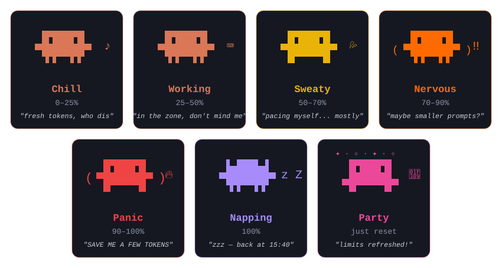

<div align="center">

# 🦀 Clawd Limits

**Your usage limits, reported by a tiny pixel creature with feelings.**



*A [Claude Code](https://claude.com/claude-code) mod that puts Clawd above your prompt to keep an eye on your **5-hour** and **weekly** limits, so you don't have to.*

</div>

---

## 🤔 Why?

Because hitting your limit mid-refactor is a jump scare. Clawd sits just above your prompt and shows you exactly how much is left, when it resets, and *how it feels about all this*.

Spoiler: the closer you get to 100%, the worse it feels.

## 🚀 Install

At the prompt of a Claude Code terminal session:

```
/plugin install clawd-limits --marketplace Alirezawmoradi/clawd-limits
```

Or from a shell:

```
claude plugin install clawd-limits --marketplace Alirezawmoradi/clawd-limits
```

Then say hi to Clawd. That's it. No config, no API keys, no feeding schedule.

> **Needs:** a recent Claude Code with mods support, and a Claude **subscription**. API-key sessions don't have 5-hour or weekly windows, so Clawd would just stand there waiting forever. Sad.

## 🎭 Meet the moods

Clawd's mood follows whichever window is **fuller**: the 5-hour one or the weekly one. As usage climbs, Clawd changes pose, colour, prop and what it says.

<div align="center">

</div>

| Usage | Mood | Colour | What Clawd does | What Clawd says |
|---|---|---|---|---|
| 0–25% | 😎 **Chill** | Clawd orange | Hums a little tune ♪♫ and dances every now and then | *"fresh tokens, who dis"* |
| 25–50% | 🙂 **Working** | Clawd orange | Taps away on a tiny keyboard ⌨ | *"in the zone, don't mind me"* |
| 50–70% | 😅 **Sweaty** | 🟡 yellow | A sweat drop 💦 appears and disappears. It's fine. Probably. | *"pacing myself... mostly"* |
| 70–90% | 😰 **Nervous** | 🟠 bright orange | Trembles every few seconds ‼ | *"maybe smaller prompts?"* |
| 90–100% | 😱 **Panic** | 🔴 red | Shakes side to side, on fire 🔥 | *"SAVE ME A FEW TOKENS"* |
| 100% | 😴 **Napping** | 🟣 purple | Eyes closed, little `z`s float up into the sky | *"zzz — back at 15:40"* |
| Just reset | 🥳 **Party** | 🩷 pink | Arms up, sparkles ✦ ✧ drift overhead, for 5 whole minutes | *"limits refreshed!"* |

### 🌵 Plus a bonus mood: Thirsty

Some tasks are *hungry*. When a single task burns through your 5-hour window fast (**1% or more per minute**) or eats a big chunk of it (**5% or more in one task**), Clawd gets **thirsty**: mouth wide open, little pink tongue out, panting, sweat 💦 on its head and 🔥 fire flickering all around it (top corners when the mouth opens, by its feet when it closes). It keeps the colour of your usage level, so a thirsty orange Clawd means "fast, but you're fine", and a thirsty yellow one means "fast *and* getting full".

```
🔥     💦 🔥
  ▐▛███▜▌   5h   █████████░░░░░░░░░░░  46%  ↻ 2h 00m · 14:00 Berlin
 ▝▜█▄ ▄█▛▘
   ▘▘▌▝▝    week ████░░░░░░░░░░░░░░░░  21%  ↻ 3d 19h · Mon 06:30 Berlin
            💧 "so... thirsty..."  🔥 2.0%/min · empty in ~27m
```

- 🔥 **Burn speed** and a **forecast**: when the 5h window would run dry at this pace, or *"lasts till reset ✓"* if you're safe.
- 🌵 **One tip per task**: *"this task is burning fast — consider /compact or a smaller model."*
- Panic, napping and party outrank thirst (they have more urgent things to say), and Clawd stops panting as soon as the task ends.

While everything is fine (under 50%), Clawd keeps its **original orange**. The colour only changes when things get interesting. The bars always wear Clawd's current colour, so you can read the mood from across the room.

## 🕺 Clawd's moves

| Move | When |
|---|---|
| 👀 **Blink** | Every 5 seconds, because staring is rude |
| 💃 **Little dance** | A sway left and right every ~10 seconds while idle (chill, working, sweaty, party) |
| 🚶 **Walk in place** | The whole time Claude is replying: Clawd is *busy* |
| 👅 **Panting** | When a task burns tokens fast: mouth open, tongue out, mouth closed, repeat |
| 🦘 **Bounce** | Whenever the mood changes, so you notice |
| 🫨 **Tremble / shake** | Nervous trembles a little; panic shakes in bursts |
| 💤 **Floating Zzz** | While napping, a `z` drifts up and turns into a `Z` |
| ✨ **Sparkles** | During the reset party |

Calm by design: nothing flashes while you're trying to read.

## 📊 What the band shows

```
 ▐▛███▜▌  5h   █████████████░░░░░░░  63%  ↻ 1h 12m · 12:12 Berlin
▝▜█████▛▘
  ▘▘ ▝▝   week ████░░░░░░░░░░░░░░░░  21%  ↻ 3d 19h · Mon 06:30 Berlin
          💦 "pacing myself... mostly"
```

- **Percent used** for each window
- **Countdown** to the reset (`↻ 1h 12m`)
- **Reset time** in 24h, in *your* time zone (Clawd reads your system clock, so you'll see your own city)
- An empty row on top and between the bars, so nothing feels cramped

### 🔔 Toasts

- 🔥 **95%**: one warning per window, so you can wrap up before Clawd falls asleep on you.
- 🎉 **Reset**: a little celebration when a window refreshes.

## ⌨️ Commands

| Command | Does |
|---|---|
| `/limits` | Hides Clawd. Run it again and Clawd comes back, no hard feelings. |

## ❓ FAQ

**Clawd says "send a message and I'll read your limits". Is it broken?**
Nope. Claude Code only learns your limits from a response, so Clawd waits for your first message in each session.

**Why is Clawd purple and asleep?**
You hit 100%. Clawd is napping until the time shown. Maybe you should take a break too. ☕

**Does Clawd cost tokens?**
Not a single one. Clawd only reads numbers Claude Code already has. No extra requests, ever.

**Can I make Clawd stop dancing?**
`/limits` hides it. Clawd will be sad, but it understands.

## 🛠️ Develop

```
claude --plugin-dir .          # run a session with the mod loaded from this folder
claude plugin validate .       # check the manifest and hooks module
claude plugin test .           # run tests/*.test.tsx
node scripts/make-art.mjs      # regenerate the README art in assets/
```

The README art is drawn from the very same block-character sprite the mod uses, so the pictures never lie.

## 📜 License

MIT. Clawd is the Claude Code mascot from Anthropic; this is an unofficial fan-made mod and is not affiliated with or endorsed by Anthropic.
